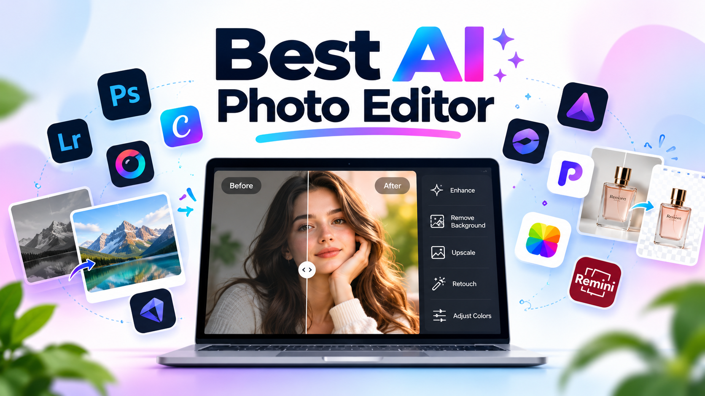

# Best AI Photo Editor in 2026: 10 Tools Compared (Honest Review 2026)

AI photo editors make it easier to improve pictures, remove backgrounds, restore old photos, and create professional-looking images. Tools like **Adobe Photoshop, Adobe Lightroom, Canva, Pixlr, Topaz Photo AI, Luminar Neo, Photoroom, Pixella, Fotor, and Remini** offer different features for different editing needs.

Whether you're a photographer, content creator, student, or small-business owner, choosing the right editor depends on your goals, budget, and experience. Some tools are better for detailed photo editing, while others are designed for quick enhancements, product photos, or creative designs.

Explore our comparison of these **10 AI photo editors in 2026** to discover their main features, strengths, and limitations. Compare the options, visit the official websites, and choose the tool that works best for your next project.

## Table of Contents

| No | Section | No | Section |
|---|---|---|---|
| 1 | [What Is an AI Photo Editor?](#what-is-an-ai-photo-editor) | 9 | [Fotor](#9-fotor) |
| 2 | [Best AI Photo Editors at a Glance](#best-ai-photo-editors-at-a-glance) | 10 | [Remini](#10-remini) |
| 3 | [Adobe Photoshop](#1-adobe-photoshop) | 11 | [How to Choose the Best AI Photo Editor](#how-to-choose-the-best-ai-photo-editor) |
| 4 | [Adobe Lightroom](#2-adobe-lightroom) | 12 | [Free vs Paid AI Photo Editors](#free-vs-paid-ai-photo-editors) |
| 5 | [Canva](#3-canva) | 13 | [Final Verdict](#final-verdict) |
| 6 | [Pixlr](#4-pixlr) | 14 | [Frequently Asked Questions](#frequently-asked-questions) |
| 7 | [Topaz Photo AI](#5-topaz-photo-ai) |  |  |
| 8 | [Luminar Neo](#6-luminar-neo) |  |  |
| 9 | [Photoroom](#7-photoroom) |  |  |
| 10 | [Pixella](#8-pixella) |  |  |

## What Is an AI Photo Editor?

An AI photo editor uses artificial intelligence to automate or simplify image editing tasks that traditionally require manual work.

Depending on the software, AI-powered features may include:

- **AI Image Enhancement:** Improve exposure, contrast, colors, and overall image appearance.
- **Background Removal:** Separate a subject from its background automatically.
- **Object Removal:** Remove unwanted objects and reconstruct the surrounding area.
- **AI Upscaling:** Increase image resolution while attempting to preserve details.
- **Portrait Retouching:** Refine skin, lighting, and facial details.
- **Generative Editing:** Add, replace, or expand image content using text prompts.
- **Noise Reduction:** Reduce grain in low-light photographs.
- **Old Photo Restoration:** Repair scratches, fading, and some image damage.

AI can speed up editing, but it does not guarantee perfect results. Hair edges, reflections, hands, text, and complex backgrounds may still require manual corrections.

## Best AI Photo Editors at a Glance

The following comparison highlights 10 AI photo editors based on their primary use cases, supported platforms, and free-access options. The tools are organized by their strengths rather than a universal ranking.

| AI Photo Editor | Best For | Platform | Free Access |
|---|---|---|---|
| Adobe Photoshop | Professional editing and generative fills | Desktop and web; mobile options available | Trial or limited access, depending on plan |
| Adobe Lightroom | Photography and color correction | Desktop, web, and mobile | Limited free access on supported platforms |
| Canva | Social media graphics and quick edits | Web, desktop, and mobile | Yes, with paid features |
| Pixlr | Browser-based photo editing | Web and mobile | Yes, with limitations |
| Topaz Photo AI | Sharpening, denoising, and upscaling | Desktop | Check current trial and licensing terms |
| Luminar Neo | Creative photography and AI enhancements | Desktop | Trial availability may vary |
| Photoroom | Product photography and background removal | Web and mobile | Yes, with limitations |
| Pixella | AI image editing and small-business branding | Web-based | Check current feature and usage limits |
| Fotor| Quick AI enhancement and portrait retouching | Web, desktop, and mobile options | Yes, with limitations |
| Remini | Portrait enhancement and old photo restoration | Primarily mobile, with web options where available | Yes, with limitations |

*Note: Free access does not necessarily mean unlimited editing or unrestricted high-resolution exports. Features, supported platforms, AI credits, trial availability, and pricing may change. Check each tool's official website before purchasing.*

## 1. Adobe Photoshop

**Best for:** Professional photo editing, compositing, and precise creative control.

Adobe Photoshop is a leading choice for photographers, graphic designers, and creative professionals who need detailed control over their images.

Its AI-powered tools help users make complex edits more efficiently while retaining access to layers, masks, selections, and traditional editing features.

### Key Features

- Generative Fill and AI-assisted content editing.
- Object selection and background manipulation.
- Layer-based editing and compositing.
- Advanced retouching and color adjustments.
- Integration with Adobe's creative ecosystem.

### Pros

- Extensive editing capabilities.
- Suitable for complex professional projects.
- Combines AI automation with manual precision.

### Cons

- Requires time to learn advanced workflows.
- Subscription costs may be unsuitable for casual users.
- Some AI features have usage limits or plan requirements.

**Review :-** A powerful AI photo editor for professional image manipulation, object removal, and creative editing. Best for users who need advanced features and precise control.

## 2. Adobe Lightroom

**Best for:** Photographers who manage large photo collections and need consistent edits.

Lightroom focuses on organizing, developing, and refining photographs. It is particularly useful for wedding photographers, travel photographers, portrait creators, and anyone processing multiple images from the same shoot.

### Key Features

- AI-powered masking and selective adjustments.
- Noise reduction on supported workflows.
- Color grading and exposure correction.
- Presets for consistent editing styles.
- Photo organization and library management.

### Pros

- Efficient for editing large collections.
- Strong photography-focused workflow.
- Useful for maintaining consistent colors and tones.

### Cons

- Less suited to complex compositing than Photoshop.
- Some advanced capabilities require a paid plan.
- Best results still depend on editing judgment and source image quality.

**Review :-** An excellent choice for improving photo colors, lighting, and image quality. Ideal for photographers who want consistent, natural-looking results.

## 3. Canva

**Best for:** Beginners, content creators, and social media designers.

Canva combines design templates with photo editing and AI-assisted creative tools. It is useful when a photograph needs to become part of a social media post, presentation, advertisement, thumbnail, or marketing graphic.

### Key Features

- AI-assisted image editing through supported Magic Studio tools.
- Background removal on eligible plans.
- Ready-made design templates.
- Text, graphics, and image composition.
- Social media resizing and content creation.

### Pros

- Beginner-friendly interface.
- Combines editing and graphic design.
- Convenient for producing content in multiple formats.

### Cons

- Advanced features may require a subscription.
- Offers less detailed photographic control than Photoshop.
- Some AI capabilities have plan-dependent limits.

**Review :-** An easy-to-use design platform with AI photo editing tools and ready-made templates. Perfect for beginners, social media creators, and small businesses.

## 4. Pixlr

**Best for:** Quick edits directly in a browser.

Pixlr provides browser-based image editing with AI-assisted features. It can be useful for students, bloggers, small-business owners, and casual users who want to edit images without installing a large desktop application.

### Key Features

- Browser-based photo editing.
- Background removal.
- AI-assisted image generation and editing tools.
- Filters, effects, and basic image adjustments.
- Design tools for everyday creative work.

### Pros

- Accessible through a web browser.
- Offers a relatively approachable editing workflow.
- Useful for quick edits and simple creative projects.

### Cons

- Free usage and export options may be limited.
- Advanced workflows may require a paid plan.
- Not a complete replacement for professional desktop software.

**Review :-** A convenient online editor for quick photo adjustments, filters, and AI-powered editing. Suitable for users who prefer editing directly in their browser.

## 5. Topaz Photo AI

**Best for:** Improving image clarity, reducing noise, and recovering detail.

Topaz Photo AI focuses on image enhancement rather than serving as a complete graphic design platform. It is especially relevant when photographs contain noticeable noise, softness, or insufficient resolution.

### Key Features

- AI-powered noise reduction.
- Image sharpening.
- Resolution enhancement and upscaling.
- Detail recovery for supported images.
- Automated enhancement workflows.

### Pros

- Focuses on specific image-quality problems.
- Useful for challenging photographs.
- Can complement a separate editing application.

### Cons

- Does not replace a full creative design suite.
- Processing demands can depend on hardware and image size.
- Enhancement cannot reliably recover every detail missing from the original.

**Review :-** Designed to sharpen images, reduce noise, and improve photo resolution. A useful option for photographers who want clearer, more detailed pictures.

## 6. Luminar Neo

**Best for:** Creative photographers who want AI-assisted enhancements.

Luminar Neo offers photography-oriented editing tools that simplify adjustments to portraits, landscapes, skies, and other visual elements.

It is suited to users who want creative results without performing every adjustment manually.

### Key Features

- AI-assisted photo enhancement.
- Portrait and landscape adjustments.
- Sky and lighting enhancements.
- Object removal and creative editing features.
- Controls for refining the final image.

### Pros

- Photography-focused editing workflow.
- Useful for creative visual transformations.
- Offers a combination of automated and manual controls.

### Cons

- Advanced processing can require capable hardware.
- Some features and licensing options may vary.
- Automated effects can look unnatural when overused.

**Review :-** Offers creative AI tools for enhancing portraits, landscapes, lighting, and other photo details. Best for photographers who want attractive results with less manual work.

## 7. Photoroom

**Best for:** E-commerce sellers, product photography, and catalog images.

Photoroom focuses on producing clean product images and marketing visuals. It is useful for online sellers who need consistent product backgrounds without arranging a full photography studio for every image.

### Key Features

- Automatic background removal.
- Product image backgrounds and staging.
- AI-assisted shadows and image composition.
- Product photography templates.
- Tools for creating marketing assets.

### Pros

- Purpose-built for product visuals.
- Helps simplify repetitive background editing.
- Useful for online stores and marketplace listings.

### Cons

- Some advanced exports and features require payment.
- Generated backgrounds may not accurately represent a real product setting.
- Less appropriate for advanced photographic retouching.

**Review :-** Makes background removal and product photo creation simple and efficient. Especially useful for e-commerce sellers and businesses creating product images.

## 8. Pixella

**Best for:** Small businesses, solo founders, and creators seeking an AI-assisted branding workflow.

Pixella is worth considering for users who want image editing and basic branding tasks in one web-based workflow.

Beyond editing existing images, its reported toolset includes features for generating visuals, removing backgrounds, improving image resolution, and preparing brand-related assets.

### Key Features

- AI image editing and cleanup.
- Background removal.
- Image upscaling.
- AI image generation.
- Logo generation and brand-kit workflows.
- Image resizing for different content formats.

### Pros

- Combines several visual-content tasks in one workflow.
- May be useful for creators working with limited design resources.
- Can reduce the need to switch between separate tools for routine tasks.

### Cons

- AI-generated logos may need substantial refinement before commercial use.
- Feature availability and usage limits should be checked before relying on it.
- Does not replace the strategic judgment of an experienced brand designer.
- Users should verify image rights, privacy terms, and output quality for their intended use.

**Review :-** Combines AI-assisted image editing with tools for creative content and branding. Worth exploring for creators and small businesses looking for a simpler design workflow.

## 9. Fotor

**Best for:** Quick AI photo enhancement, portrait retouching, and creative edits.

Fotor is an accessible photo editing platform that combines traditional editing tools with AI-powered enhancements. It is suitable for users who want to improve photographs without learning a complex professional workflow.

### Key Features

- AI photo enhancement.
- Portrait retouching and beauty effects.
- Background removal on supported plans.
- AI image generation and editing tools.
- Filters, effects, and creative design features.

### Pros

- Beginner-friendly editing experience.
- Offers multiple creative tools in one platform.
- Useful for everyday photo improvements.

### Cons

- Some features require a paid plan or credits.
- Results can vary depending on the original image.
- Advanced professional workflows may require other software.

**Review :-** Provides quick photo enhancement, portrait retouching, and creative editing features. A practical option for beginners who want to improve images without complicated steps.

## 10. Remini

**Best for:** Enhancing portraits and restoring the appearance of old or low-quality photos.

Remini focuses on AI-powered image enhancement, particularly for portraits, older photographs, and images with limited visible detail. It is useful for users who want to improve the apparent clarity of existing images.

### Key Features

- AI photo enhancement.
- Portrait and face-detail enhancement.
- Old photo restoration.
- Video enhancement features in supported versions.
- Mobile-focused editing workflows.

### Pros

- Simple enhancement process.
- Useful for some blurry or low-resolution portraits.
- Suitable for quick restoration attempts.

### Cons

- Enhanced facial details may not accurately reflect the original person.
- Free usage and export options may be limited.
- Results can look artificial on heavily damaged photographs.

**Review :-** Focuses on enhancing portraits and improving the appearance of old or blurry photographs. Useful for photo restoration, although AI-generated details may not always be accurate.

## How to Choose the Best AI Photo Editor

The right choice depends on your actual workflow. Instead of selecting a tool based only on popularity, identify the task you perform most often.

| Your Requirement | Recommended Tool |
|---|---|
| Professional photo manipulation | Adobe Photoshop |
| Editing photography collections | Adobe Lightroom |
| Social media designs | Canva |
| Quick browser-based edits | Pixlr |
| Fixing noisy or soft photographs | Topaz Photo AI |
| Creative photo enhancement | Luminar Neo |
| Product background removal | Photoroom |
| Image editing plus basic branding | Pixella |

### Consider These Five Factors

**1. Image quality**

Check how naturally the editor handles edges, fine details, skin textures, shadows, and complex backgrounds.

**2. Ease of use**

A beginner may benefit more from an intuitive editor than from professional software with a steep learning curve.

**3. Pricing and limitations**

Check subscription costs, free-plan limits, AI credits, export restrictions, and commercial-use terms.

**4. Platform compatibility**

Confirm that the application supports your operating system, hardware, image formats, and preferred workflow.

**5. Privacy and ownership**

Before uploading confidential or client photographs, review how the service stores and processes images and what rights apply to generated outputs.

## Free vs Paid AI Photo Editors

Free tools are often sufficient for simple tasks, but the word *free* does not always mean unlimited use.

| Feature | Free or Limited Plans | Paid Plans |
|---|---|---|
| Basic adjustments | Often available | Usually available |
| Background removal | May have usage limits | Often includes expanded access |
| AI generation | May have limited credits | Usually offers additional usage |
| High-resolution exports | May be restricted | Depends on the plan |
| Professional workflows | Varies by application | Often includes more advanced tools |

### Which Option Should You Start With?

- **For simple designs:** Try Canva's free plan.
- **For browser editing:** Explore Pixlr's free features.
- **For professional editing:** Evaluate Photoshop against your actual requirements.
- **For product photos:** Test Photoroom on a few representative products.
- **For image restoration:** Compare the results from a specialist enhancer such as Topaz Photo AI.
- **For branding workflows:** Explore Pixella and verify which features are available without payment.

Always test your own images before paying for a subscription.

## Final Verdict

Choosing the right AI photo editor depends on your needs, budget, and editing skills. Adobe Photoshop and Lightroom are suitable for advanced photo editing, while Canva, Pixlr, and Fotor offer accessible options for everyday creative work. Topaz Photo AI, Luminar Neo, Photoroom, Pixella, and Remini provide different tools for image enhancement, creative editing, branding, product photography, and photo restoration.

Before choosing a tool, compare its features, pricing, and limitations to find the best fit for your workflow. **Explore the tools listed in this guide, try the options that match your needs, and choose the one that helps you achieve better results.**

If you found this guide useful, consider giving this repository a ⭐ **star on GitHub** to support the project and help more people discover it. Your feedback and suggestions are always welcome!

## Frequently Asked Questions

### 1. What is the best AI photo editor in 2026?

There is no single winner for every workflow. Adobe Photoshop is a strong option for professional editing, Lightroom for photography libraries, Canva for design, and Photoroom for product imagery.

### 2. Which AI photo editor is best for beginners?

Canva and Pixlr are accessible starting points for simple editing and design. The better option depends on whether you need social graphics or direct photo manipulation.

### 3. Are AI photo editors free?

Some offer free plans, limited AI credits, or trial periods. Other features may require a subscription or separate payment. Always check the current terms.

### 4. Can AI remove objects from photos?

Many editors can remove unwanted objects and generate replacement pixels. Results depend on the object's shape, the background, and the complexity of the scene.

### 5. Can AI improve a blurry photo?

AI enhancement tools can sharpen some images and reduce noise, but they cannot guarantee accurate recovery of details that were never captured.

### 6. Which AI photo editor is best for product photography?

Photoroom is designed for product imagery and background workflows. Photoshop is another option when you need more detailed manual control.

### 7. Can AI photo editors replace professional designers?

They can automate routine editing and help produce initial concepts. However, brand strategy, complex creative direction, and high-stakes commercial work may still benefit from professional expertise.
